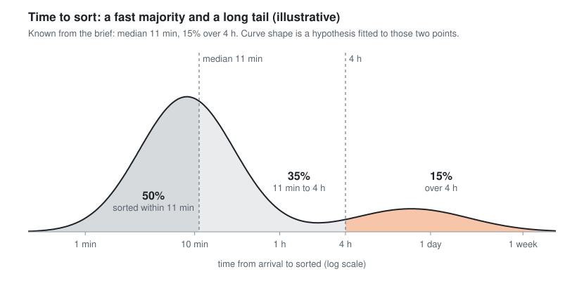

# Time to sort: reading the distribution

What the brief's time-to-sort numbers do and don't tell us, and what we'd ask for first.

*Chart generated by [`assets/make_time_to_sort_chart.py`](assets/make_time_to_sort_chart.py). The curve shape is illustrative.*

## What we know vs what we infer

| Statement | Status |
|---|---|
| Half of claims are sorted within 11 min | **From the brief**, by definition of median |
| 15% of claims take over 4 h (~315k claims/year) | **From the brief** |
| 35% take between 11 min and 4 h | **Derived**, arithmetic on the two above |
| The distribution is two groups: a fast majority (minutes) and a stalled tail (hours to days) | **Inferred**. A single smooth curve through the two points would need ~1 in 5 claims sorted in under a minute and an average of ~15 h, which isn't believable. Two groups fit far better |
| Average time to sort is ~6 h; the tail holds most of the waiting time | **Inferred from the illustrative curve**. Hypothesis, not a number for the deck |

## Median vs average

- **Median**: line every claim up from fastest to slowest; it's the one in the middle.
- **Average (mean)**: add up all the times and divide by the number of claims.

They match when data is symmetric. With a long tail they split: the average gets dragged toward the extreme values, the median doesn't.

Example with five claims of 5, 8, **11**, 15 and 2,000 min: the median is 11 min, the average is ~408 min (~7 h). One stuck claim moves the average massively and leaves the median untouched.

## What this means for Keelwater

- **The median of 11 min tells us what a typical claim looks like. It's quick.**
- It tells us nothing about the slow end. The 15% over 4 h could take 5 hours or 5 days and the median would still be 11 min. The brief gives no average.
- **For the problem we're solving, the slow end is what matters.** This is an assumption, see [A-15](../01-thinking/assumptions-log.md).
- **Does the slow end hold most of the total handler time and customer waiting time?** Both an assumption ([A-16](../01-thinking/assumptions-log.md)) and an open question ([DQ-10](../01-thinking/open-questions.md)). It may hold for waiting time but not for handler time: 2.1M claims × a few minutes of handler effort each could add up to more effort than the tail.

## Research: first ask to the data team

**The real histogram of time to sort ([DQ-02](../01-thinking/open-questions.md)) is the first thing to ask the data team for**, together with what "time to sort" measures ([DQ-01](../01-thinking/open-questions.md)). Everything above about the shape is inferred from two points; the histogram replaces the hypothesis with data, ideally split by customer, pile and arrival time ([DQ-03](../01-thinking/open-questions.md)).
