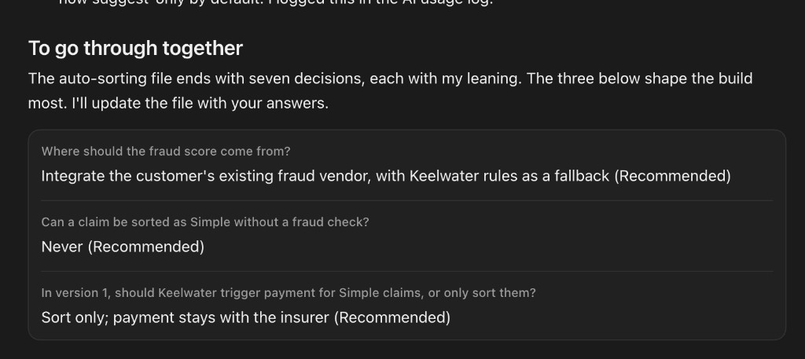

# AI usage log

Running log for the "How you used AI" part of the recording. Capture what AI did, what I kept, what I overrode, and anything it got wrong.

| Date | Task | Tool | What it produced | What I changed / overrode | Wrong or rejected? |
|---|---|---|---|---|---|
| 2026-10-15 | Brainstorm session | Claude (voice / chat) | Structured notes from spoken brainstorm | | |
| 2026-10-15 | Organising context into repo | Claude (Cowork) | Repo structure, fact sheet with derived numbers, brainstorm organised by task question, assumptions log | | Flagged: "fraud is the blocker" isn't in the brief; a wrong company name in the data-privacy notes (fixed); brainstorm holds two contradictory bulk-sorting options |
| 2026-10-15 | Testing "sorting helps with fraud" | Claude (web research) | Research note on motor claims triage, fraud scale, signals, regulation | Michelle chose motor claims as the domain and asked to test the fraud assumption rather than accept it | Partly rejected my own framing: triage is mainly about speed; fraud screening is the gate that makes speed safe. Several sources are vendor blogs, flagged as directional |
| 2026-10-15 | Reading the time-to-sort data | Cursor (Claude) | Illustrative distribution fitted to the two known points (median 11 min, 15% > 4h): fast majority plus a stalled tail that holds most of the waiting time | Michelle challenged "half sorted within 11 min" (correct by definition of median, but only if "time to sort" means what we think) | The curve shape is inferred, not data; labelled illustrative. Raised DQ-01: is time to sort elapsed time or handler time? |
| 2026-10-15 | Discovery questions by stakeholder | Cursor (Claude) | Brainstorm questions + data questions consolidated in open-questions.md, grouped by who to ask (data, engineering, product leadership, sales, CS/AM, support, customers, legal) | | |
| 2026-10-16 | Testing "pile 2 = information missing" | Cursor (Claude, web search) | Research §6: how motor claims are triaged (fast track / standard / complex / fraud investigation) | Michelle challenged the pile 2 definition | Rejected AI's earlier definition; I-02 revised |
| 2026-10-16 | Consolidated triage research; auto-sorting and examiner research | Cursor (Claude, web search) | Merged duplicated sections; new files on auto-sorting design (decision order, data, fraud score sources) and examiner requirements (NAIC bulletin, Colorado, Florida bill, ICOBS 8, Consumer Duty, UK GDPR 22A–22D) | | Earlier note said auto-routing to Suspicious is "safer" than auto-paying Simple. True for fraud risk, not for regulation: Suspicious routing profiles claimants and needs bias testing. Now suggest-only by default |
| 2026-10-16 | Decisions on the auto-sorting design | Cursor (Claude, question form) | Instead of writing decisions into the doc itself, AI asked Michelle to choose on the three decisions that shape the build, each with options and a recommendation | Michelle chose: integrate the customer's fraud vendor (AS-01), never Simple without a fraud check (AS-02), sort only in v1 (AS-04) | AI recorded them as decided in [auto-sorting-requirements.md](../02-research/auto-sorting-requirements.md) only after the answers came back |
| 2026-10-16 | Reviewing a Kaggle claim dataset and prediction notebook | Cursor (Claude) | Review of what to reuse: leakage handling, balanced accuracy, simple vs complex model, history features, claim amount distribution | Michelle found the dataset and notebook and suggested reusing the logic | AI flagged the notebook predicts *whether someone will claim* (underwriting), not how to handle a filed claim, and uses demographic features that would be unfair in claims routing |
| 2026-10-16 | Sample-data sorting prototype | Cursor (Claude, Python) | [Prototype](prototype/results.md): gradient-boosted model on the Kaggle claims with invented claim fields and rule-made labels; per-claim reasons traced from the trees; example bulk sorting table with missing-info and pre-payment review statuses | Michelle pointed out that the earlier write-up's "no reasons per claim" was wrong for a tree model, and asked to recreate the prototype on sample data as a concept | First run labelled 23% of claims Suspicious (a blunt "claim worth more than the car" rule); AI tightened it to 16%, still flagged as too high. Some traced reasons don't match the rule that decided the pile, which is noted as a limit |

## Checking I've read and understood AI output

AI shouldn't make product decisions silently in a document I might skim. For decisions that shape the build, it summarised the research in the chat, then asked me to choose in a structured form before writing anything down as decided.

*Screenshot from Cursor: the AI's questions with my submitted answers.*

- **What it does well:** forces an explicit choice on each decision, keeps a record of who decided, and means the doc only says "decided" when a human decided it.
- **Watch-out:** every option I picked was the one marked "Recommended". I agreed with the reasoning, but recommended labels can nudge. It's the same automation bias regulators warn about for claims handlers confirming AI suggestions ([examiner-requirements.md](../02-research/examiner-requirements.md)). Worth saying in the recording.

## Candidates for "one thing it got wrong"

Note them as they come up, pick the strongest at the end.

- AI invented per-customer data where complex-heavy insurers were the biggest accounts (~28k claims each) and simple-heavy the smallest (~8.6k). The totals matched the brief, but the logic was backwards: simple claims are the most common and large personal motor insurers handle the most claims. Michelle caught it; segments rebalanced in [internal-data.md §1](../02-research/internal-data.md). Lesson: invented data can be arithmetically consistent and still implausible.
- AI listed "above the handler's authority limit" (7%) as a cause of slow sorting. It came from research on why claims are slow end to end, but authority limits apply when a claim is paid, not when it's sorted. Michelle asked what it meant and why it was there; it was removed from the causes and became a review step before payment for very high-value Simple claims (A-20). Lesson: check that research about the whole claim journey actually applies to the step you're measuring.

- Brainstorm (AI-structured) treated "fraud is the blocker" as fact. The brief never says that; research suggests speed is the primary ask.
- AI carried "pile 2 = information missing" through the fact sheet, research and assumptions (I-02), and even called missing info "the largest addressable category". Michelle questioned it; a quick search on how motor claims are triaged showed the middle pile is about complexity and judgement (third party, injury, disputed liability, total loss, above authority). Missing info is a status on any claim, not a pile. In the source AI had cited, "adjuster review" (30%) was bigger than missing info (20%). See [research §2](../02-research/motor-claims-triage-and-fraud.md).
